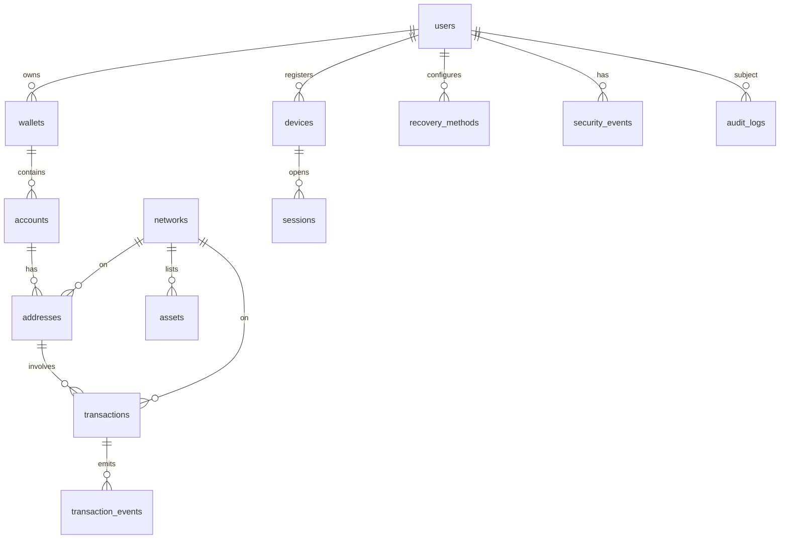

# QD Wallet — V1 Technical Specification

| | |
|---|---|
| Status | **DRAFT — awaiting review and approval** |
| Scope | Milestone 0 (specification only; no application code) |
| Date | 2026-09-24 |
| Supersedes | — |

This document is the reference for QD Wallet V1. It defines what we build, where each responsibility lives, what we trust, and in what order we build it. Nothing in `apps/`, `services/` or `packages/` should be written until the decisions in [§0](#0-decisions-required-before-milestone-1) are resolved.

---

## Table of contents

0. [Decisions required before Milestone 1](#0-decisions-required-before-milestone-1)
1. [Product overview](#1-product-overview)
2. [User personas](#2-user-personas)
3. [Core user journeys](#3-core-user-journeys)
4. [Functional requirements](#4-functional-requirements)
5. [Non-functional requirements](#5-non-functional-requirements)
6. [System architecture](#6-system-architecture)
7. [Frontend (web) architecture](#7-frontend-web-architecture)
8. [Mobile architecture](#8-mobile-architecture)
9. [Backend architecture](#9-backend-architecture)
10. [Wallet-core architecture](#10-wallet-core-architecture)
11. [Ethereum / EVM architecture](#11-ethereum--evm-architecture)
12. [Monero architecture](#12-monero-architecture)
13. [Key-management architecture](#13-key-management-architecture)
14. [HD wallet lifecycle](#14-hd-wallet-lifecycle)
15. [QD/MPC integration architecture](#15-qdmpc-integration-architecture)
16. [Transaction lifecycle](#16-transaction-lifecycle)
17. [Recovery lifecycle](#17-recovery-lifecycle)
18. [Database ER model](#18-database-er-model)
19. [API specification](#19-api-specification)
20. [Security threat model](#20-security-threat-model)
21. [Trust boundaries](#21-trust-boundaries)
22. [Authentication model](#22-authentication-model)
23. [Authorization model](#23-authorization-model)
24. [Secret-management model](#24-secret-management-model)
25. [RPC architecture](#25-rpc-architecture)
26. [Observability architecture](#26-observability-architecture)
27. [Testing strategy](#27-testing-strategy)
28. [CI/CD architecture](#28-cicd-architecture)
29. [Deployment architecture](#29-deployment-architecture)
30. [Development roadmap](#30-development-roadmap)
- [Appendix A — UX and motion system](#appendix-a--ux-and-motion-system)
- [Appendix B — Proposed ADR index](#appendix-b--proposed-adr-index)
- [Appendix C — Risk register](#appendix-c--risk-register)
- [Appendix D — Glossary](#appendix-d--glossary)

---

## 0. Decisions required before Milestone 1

These decisions affect security, custody, or what can be built. Each one has a recommendation, but none is final until it is approved. Section 31 of the brief says ambiguous security decisions must be escalated rather than made silently, so they are listed here first.

### D1 — What exactly is "the QD-Wallet research"? **(resolved 2026-09-25)**

> **Resolved.** The source is the QD-Wallet paper (Thomas et al.): a lattice-based Threshold Raccoon wallet, not threshold ECDSA. See [docs/qd-protocol/README.md](../qd-protocol/README.md) and ADR 0014. The paragraphs below are the original open question, kept for history.

The brief names the QD-Wallet research as the cryptographic foundation, but no paper, protocol or reference implementation is attached. This spec does **not** guess its contents. Until it is provided:

- The signer abstraction (§13, §15) is built so that it works with *any* threshold scheme.
- The MPC design in §15 uses established, peer-reviewed threshold-ECDSA protocols (CGGMP21 or DKLs23) as the working assumption.
- A document at `docs/qd-protocol/` will record the QD protocol's security assumptions, message flow and deviations from standard threshold ECDSA once we have the source.

**Needed from you:** the paper or preprint (title, authors, link), any reference code, and whether "QD" names a specific scheme (e.g. a particular share-refresh or key-derivation construction) or a general research direction.

### D2 — Monero custody model **(blocking for Milestone 5)**

As drawn in the brief, the Monero path (`Go backend → monero-wallet-rpc → monerod`) would put the Monero **private spend key on the server**. That makes Monero **custodial**, which contradicts the non-custodial goal and the rule that the recovery phrase is never sent to the backend. Handing the server even the private *view* key lets it see every incoming transaction, which undermines Monero's main privacy property.

| Option | Custody | Privacy | Complexity | Mobile feasibility |
|---|---|---|---|---|
| **A. Client-side wallet** (monero-ts WASM on the device; backend proxies a restricted `monerod`) | Non-custodial | Strong; the server sees only the IP address and the fact that a sync is happening | Medium | **Risk**: WASM on React Native/Hermes is limited. Needs a spike; a native module may be required |
| **B. Server view-only wallet + client cold-signing** (backend `monero-wallet-rpc` holds the view key only; the client signs `unsigned_txset` and exports key images) | Non-custodial for spending | **Weak**: the operator sees all incoming funds | High (key-image sync, one wallet-rpc process per open wallet) | Good |
| **C. Server full wallet** (as drawn in the brief) | **Custodial** | None from the operator | Low | Good |

**Recommendation: A**, with B offered only as an explicit opt-in "fast sync" that states the privacy trade-off. C is rejected. Under A, `monero-wallet-rpc` is used only for local development and integration tests, not in production.

### D3 — Monero key derivation from the shared BIP-39 root

Monero does not use BIP-32/BIP-39 natively. Its native seed format is a 25-word Electrum-style mnemonic, or Polyseed in newer wallets. There are two options:

- **(a) One BIP-39 phrase for everything.** Derive the Monero spend key from the BIP-39 seed with a hardware-wallet-compatible scheme (SLIP-10 ed25519 path `m/44'/128'/account'`, then reduction to a Monero scalar). The exact construction must be verified against Trezor/Ledger vectors before we commit to it. We also show a Monero-native 25-word export so users can recover in other Monero wallets.
- **(b) A separate Monero seed**, backed up independently.

**Recommendation: (a)**, conditional on a Milestone 5 spike that reproduces the published test vectors of an existing wallet. If no interoperable scheme can be verified, fall back to (b) rather than invent a derivation.

### D4 — Web form factor and the "hosted wallet code" threat

A wallet served as a hosted website loads its signing code from a server on every visit. Anyone who compromises the hosting, CDN, DNS or build pipeline can ship JavaScript that steals seeds. This is the main reason MetaMask ships as a browser extension. Options:

- **Hosted Next.js (static export) + hardening**: strict CSP, SRI, separate origin from the API, signed and reproducible builds, a published build hash, and optionally an IPFS-pinned mirror. This is the recommendation for V1, with the residual risk documented.
- **Browser extension** (a later milestone). It also enables EIP-1193 provider injection, which dApp connectivity needs.

**Recommendation:** V1 is a hosted static web app with the residual risk stated openly. Keep the UI package portable so it can move into an extension later.

### D5 — Web vault storage

The brief says the seed must "never be persisted in ordinary browser storage". Strictly read, a web user would have to re-enter the phrase in every session, which is not viable. **Recommendation:** store only an **encrypted vault** in IndexedDB, as MetaMask does: AES-256-GCM, with the key derived from the user's password via Argon2id (parameters fixed in an ADR). Plaintext must never touch `localStorage`, `sessionStorage`, cookies, IndexedDB or the backend. WebAuthn PRF can be offered as an optional unlock factor where the browser supports it. **Please confirm that an encrypted vault is acceptable.**

### D6 — Where transactions are built and signed

The brief puts `buildTransaction`/`signTransaction` in the adapter interface and also lists `blockchain/evm` and `blockchain/monero` in the Go backend. **Recommendation:**

- **Build, verify and sign on the client**, which holds the key. The TypeScript adapters in `packages/evm` and `packages/monero` implement the full `BlockchainAdapter`.
- **The Go backend implements a read/relay subset**: RPC proxy, history indexing, fee data, broadcast relay, and the MPC co-signer in Milestone 7. It never builds the payload the user signs. This way a compromised backend cannot change what the user sees and signs.

### D7 — Role of Wagmi

Wagmi is a library for dApps that *connect to* wallets. QD Wallet *is* the wallet, so Wagmi's connectors add nothing. **Recommendation:** use **Viem** directly with a custom local account, plus **TanStack Query** (which Wagmi uses internally) for caching. Reserve Wagmi for a possible internal dApp test harness. dApp connectivity in V1.x uses **WalletConnect v2 (Reown WalletKit)**, the wallet-side SDK.

### D8 — Spending policies under HD signing

With HD signing, whoever holds the seed can sign anything, so client-side policies (daily limits, allowlists) are **advisory UX guardrails, not security controls**. Policies become enforceable only once a server-side co-signer holds a share (Milestone 7). The spec keeps this distinction explicit so we never claim otherwise in the UI.

### D9 — Account identity and privacy

The backend needs to know a user's addresses to index history and send notifications. That links addresses to a device and IP address on our infrastructure. **Recommendation:** the backend account is keyed by a device public key, not an email address. Address registration is per network and can be revoked. For Monero under option A, the server stores **no** Monero address at all. Email is optional and only used for security notifications.

### D10 — Pricing data source

USD values require a price feed (e.g. CoinGecko, CoinMarketCap). This is a new third-party dependency, and it also leaks which assets the user holds unless it goes through our backend. **Recommendation:** the backend fetches and caches prices for a whole token list, not per user, so the provider cannot see individual portfolios.

---

## 1. Product overview

QD Wallet is a non-custodial, multi-chain wallet for Ethereum, EVM-compatible networks and Monero, with web and mobile clients.

**V1 value proposition**

1. It feels immediately familiar to MetaMask users: the same interaction model with an original visual identity.
2. It keeps Monero's privacy model intact instead of flattening it into an EVM-shaped wallet.
3. It is built from day one around a signer abstraction, so HD keys can later be augmented or replaced by threshold (QD/MPC) signing without rewriting the blockchain layer.

**Non-goals for V1**

- Custodial accounts, fiat on/off-ramp, swaps, staking, NFTs (these get placeholder slots in the navigation, §7.3).
- Browser extension / EIP-1193 injection (see D4).
- Hardware-wallet support. It is designed for in the signer abstraction but not built.
- Self-hosted Ethereum nodes (planned for Milestone 8+).
- MPC signing for Monero. Threshold CLSAG is not a mature, standardised construction; see §15.7.

**Custody statement (to be shown in the product and the docs)**

> QD Wallet never has access to your recovery phrase or private keys. In HD mode, your device alone controls your funds. In the future QD/MPC mode, no single party, including QD Wallet, can sign alone.

---

## 2. User personas

| Persona | Description | Needs | Design implications |
|---|---|---|---|
| **Maya — MetaMask regular** | Uses MetaMask daily on desktop and mobile; bridges to L2s | Familiar flows, fast network switching, clear gas fees | Mirror MetaMask's hierarchy: account and network pickers in the header, Send/Receive as primary actions, Activity tab |
| **Tomás — privacy-first Monero user** | Holds XMR, runs his own node sometimes | No server-side view keys, custom node support, subaddresses | Client-side Monero (D2-A), custom `monerod` URL setting, subaddress per receive |
| **Priya — security-conscious holder** | Holds meaningful value, fears phishing and device loss | Strong confirmation screens, recovery options, future multi-party signing | Security centre, address-poisoning warnings, the path to MPC |
| **Sam — newcomer** | First self-custody wallet | Guidance, plain-language errors, backup nudges | Progressive disclosure, a backup reminder until recovery is verified, friendly error copy |
| **Dev/QA — internal** | Builds and tests against Anvil/regtest | Deterministic local chains, seeded fixtures | Docker-compose stack, `make dev`, test mnemonics used only on local networks |

---

## 3. Core user journeys

### 3.1 Create wallet
```
Welcome → Create wallet → Security explainer (3 cards) → Set password (web) / PIN + biometrics (mobile)
 → Generate (on device; animated) → Reveal phrase (blurred until tapped, screenshot-guarded on mobile)
 → Verify (select 3 words in position) → Wallet ready (Account 1, default network Ethereum)
```
Users can skip backup, but a persistent "Back up your wallet" banner then appears, and sending more than a threshold is blocked until backup is done (configurable; see D8, this is advisory).

### 3.2 Import wallet
```
Welcome → Import → Enter phrase (12/15/18/21/24 word grid; per-word BIP-39 wordlist autocomplete; paste splits into cells)
 → Local checksum validation → Set password/PIN → Account discovery (scan index 0..n for activity, gap limit 5)
 → Wallet ready
```

### 3.3 Receive
```
Home → Receive → Select network/asset → QR + address (EVM: checksummed; XMR: new subaddress)
 → Copy (haptic + toast "Address copied") / Share
```

### 3.4 Send (EVM)
```
Home → Send → Select asset → Recipient (paste/scan/contacts/own accounts) → Validation + risk checks
 → Amount (fiat/crypto toggle, Max) → Fee (Low/Market/Aggressive, advanced EIP-1559 editor)
 → Review (From, To, Asset, Amount, Network, Network fee, Total) → Unlock/biometric
 → Sign → Broadcast → Pending (in Activity with a live status) → Confirmed/Failed toast
```

### 3.5 Send (Monero)
Same shape. Differences: priority tiers instead of gas; a "Funds unlock after ~20 minutes (10 blocks)" note for change outputs; no nonce concept; the review screen shows a ring-size/privacy note only in the advanced disclosure.

### 3.6 Account management
Create account (next BIP-44 index) → rename inline → switch via the header account picker (animated list; the balance cross-fades) → per-account QR, copy, and activity filter.

### 3.7 Network switching
Header network pill → bottom sheet (mobile) / dropdown (web) → grouped list (Mainnets, Testnets, Monero) → the switch updates the balance with a skeleton, then a count-up.

### 3.8 Lock/unlock and session expiry
Auto-lock after inactivity (default 15 min web, 5 min mobile background) → unlock with password/PIN/biometrics → the backend session refreshes silently.

### 3.9 Recovery on a new device
Import the phrase (HD). In MPC mode (Milestone 7), follow the recovery flow in §17.

---

## 4. Functional requirements

Priority: **M** = must (V1), **S** = should (V1 if time allows), **L** = later.

### 4.1 Wallet
| ID | Requirement | P |
|---|---|---|
| W-1 | Generate a BIP-39 mnemonic (128 or 256 bits of entropy) from a CSPRNG on the device | M |
| W-2 | Import a BIP-39 mnemonic with local checksum validation and wordlist autocomplete | M |
| W-3 | Force a recovery-phrase backup and verification step (skippable, with persistent reminders) | M |
| W-4 | Encrypted local vault; lock/unlock; auto-lock | M |
| W-5 | Reveal the recovery phrase after re-authentication, with a warning screen | M |
| W-6 | Wipe the wallet from the device | M |
| W-7 | Multiple wallets (distinct seeds) on one device | L |

### 4.2 Accounts
| ID | Requirement | P |
|---|---|---|
| A-1 | Derive Account N (EVM `m/44'/60'/0'/0/N`) | M |
| A-2 | Create, rename, switch, and hide accounts | M |
| A-3 | Copy the address, show a QR, view per-account activity | M |
| A-4 | Account discovery on import | M |
| A-5 | Import a single private key (non-HD account) | L |

### 4.3 Networks and assets
| ID | Requirement | P |
|---|---|---|
| N-1 | Network registry: Ethereum, Sepolia, Base, Arbitrum One, Polygon PoS (+ Anvil in dev) | M |
| N-2 | Monero mainnet + stagenet (+ regtest in dev) | M |
| N-3 | Native balance + ERC-20 balances from a curated token list per chain | M |
| N-4 | Add a custom ERC-20 by contract address (with a warning) | S |
| N-5 | Add a custom EVM network (chain ID verified against the RPC) | L |
| N-6 | Fiat valuation (USD first) | M |

### 4.4 Transactions
| ID | Requirement | P |
|---|---|---|
| T-1 | Send native and ERC-20 on EVM using EIP-1559 (legacy gas where a chain requires it) | M |
| T-2 | Send XMR to standard, sub- and integrated addresses | M |
| T-3 | Fee estimation with 3 tiers + an advanced editor | M |
| T-4 | Review screen showing From/To/Asset/Amount/Network/Fee/Total | M |
| T-5 | Pending tracking, then confirmation or failure notification | M |
| T-6 | Speed up / cancel a pending EVM tx (same-nonce replacement) | S |
| T-7 | Transaction history for native + ERC-20 transfers, and XMR | M |
| T-8 | Human-readable error mapping (§16.6) | M |
| T-9 | Address-book contacts | S |
| T-10 | dApp connection via WalletConnect v2, with a signing request UI | L (V1.x) |
| T-11 | Transaction simulation before signing (dApp requests) | L |

### 4.5 Security
| ID | Requirement | P |
|---|---|---|
| S-1 | Device registration and listing; remote session revocation | M |
| S-2 | Security events feed (new device, reveal phrase, failed unlocks, policy hits) | M |
| S-3 | Address-poisoning detection and warnings | M |
| S-4 | First-time-recipient warning; contract-address warning when sending to a token contract | M |
| S-5 | Client-side spending guardrails (advisory under HD, D8) | S |
| S-6 | Server-enforced policies (MPC mode) | L (M7) |

---

## 5. Non-functional requirements

| Area | Requirement |
|---|---|
| **Security** | No secret material (mnemonic, seed, private keys, unprotected shares, vault password) ever leaves the device, reaches the backend, or appears in logs, analytics or crash reports. Enforced by design, by lint rules (§27.4), and by log redaction tests |
| **Performance (web)** | First load under 2.5 s LCP on a mid-tier laptop over 4G; the wallet shell under 250 KB JS gzip before route code; interactions respond within 100 ms |
| **Performance (mobile)** | Cold start under 2 s on mid-tier Android; animations at 60 fps on the UI thread (Reanimated worklets) |
| **Availability** | API 99.9 % monthly (V1 target). Wallets stay usable read-only if the backend is down; sending on EVM falls back to a public RPC only after the user explicitly opts in |
| **Latency** | Balance refresh p95 under 1.5 s; broadcast acknowledgement p95 under 2 s |
| **Accessibility** | WCAG 2.2 AA; full keyboard navigation on web; VoiceOver/TalkBack labels; respects reduce-motion |
| **i18n** | All copy externalised; English only at launch; amounts and dates formatted per locale |
| **Privacy** | No third-party analytics SDKs that receive addresses. Product analytics are self-hosted and event-based with an allowlisted schema. The IP-to-address link is minimised and retained for at most 30 days |
| **Maintainability** | Strict TypeScript; `golangci-lint`; exported functions in `wallet-core` covered by unit tests; ≥ 90 % branch coverage on `wallet-core`, `evm`, `transaction` |
| **Portability** | Blockchain logic lives in framework-free TS packages shared by web and mobile |
| **Auditability** | Append-only audit log for security-relevant server actions (§9.6) |

---

## 6. System architecture

### 6.1 Context

```
                    ┌───────────────────────────────────────────────┐
                    │                 USER DEVICE                   │
                    │  ┌───────────────┐      ┌──────────────────┐  │
                    │  │  Web app      │      │  Mobile app      │  │
                    │  │  (Next.js)    │      │  (Expo / RN)     │  │
                    │  └──────┬────────┘      └────────┬─────────┘  │
                    │         └──── shared TS packages ┘            │
                    │   wallet-core · evm · monero · transaction    │
                    │   (keys generated, held, and used ONLY here)  │
                    └──────────────────┬────────────────────────────┘
                                       │ HTTPS (TLS 1.3), JSON / JSON-RPC
                                       ▼
                    ┌───────────────────────────────────────────────┐
                    │            wallet-api  (Go monolith)          │
                    │ auth · devices · accounts · rpc-proxy ·       │
                    │ history · prices · tx-tracking · audit ·      │
                    │ policy (M6) · mpc co-signer (M7, isolated)    │
                    └───┬────────────┬────────────┬─────────────┬───┘
                        │            │            │             │
                  ┌─────▼───┐  ┌─────▼────┐ ┌─────▼──────┐ ┌────▼─────────┐
                  │Postgres │  │  Redis   │ │ EVM RPC    │ │ monerod      │
                  │         │  │cache/rate│ │ providers  │ │ (restricted) │
                  └─────────┘  │ /queues  │ │ Alchemy,   │ └──────────────┘
                               └──────────┘ │ Infura, QN │
                                            └────────────┘
```

### 6.2 Architectural principles

1. **Keys stay where they are used.** The component that shows the user what they are signing is the component that builds and signs it (D6).
2. **Blockchain logic lives in adapters.** UI components call hooks, hooks call adapters, and only adapters know chain specifics.
3. **Signing goes through one interface.** `Signer.sign(request)` is the only way to produce a signature (§13).
4. **The backend is untrusted for custody.** A fully compromised backend can deny service, lie about balances or history, and deanonymise users. It must not be able to move funds. §20 is written against this goal.
5. **Modular monolith.** One Go binary with internal packages and enforced import boundaries. The MPC co-signer is the one exception: it is designed so it can be extracted into a separate process with its own keys (Milestone 7).

### 6.3 Repository layout

The working directory `wallet/` is the monorepo root. Tooling: **pnpm workspaces + Turborepo** for TS, and Go modules for `services/`.

```
wallet/
├── apps/
│   ├── web/                    Next.js (App Router, static export)
│   └── mobile/                 Expo (dev client, not Expo Go)
├── services/
│   └── wallet-api/             Go modular monolith
│       ├── cmd/wallet-api/
│       ├── internal/
│       │   ├── auth/  wallet/  account/  keys/  signer/  transaction/
│       │   ├── blockchain/{evm,monero}/   rpc/  policy/  recovery/
│       │   ├── security/  audit/  prices/  platform/{db,cache,otel,config}
│       └── pkg/                (only genuinely reusable, stable code)
├── packages/
│   ├── shared-types/           Domain types + generated API client (from OpenAPI)
│   ├── wallet-core/            Mnemonic, vault, derivation, Signer interface, HDSigner
│   ├── blockchain/             BlockchainAdapter interface, network registry, errors
│   ├── evm/                    EVMAdapter (viem)
│   ├── monero/                 MoneroAdapter (monero-ts)  — per D2
│   ├── rpc/                    Client-side transport to the wallet-api RPC proxy
│   ├── transaction/            Send state machine, validation, fee models, error mapping
│   └── ui/                     Design tokens, motion tokens, cross-platform primitives
├── infrastructure/
│   ├── docker/                 compose files, Dockerfiles, monerod regtest config
│   └── kubernetes/             (Milestone 8)
├── docs/
│   ├── architecture/  (this file, ADRs under adr/)
│   ├── security/      (threat model detail, incident runbooks)
│   ├── qd-protocol/   (D1)
│   └── api/           (openapi.yaml)
├── .github/workflows/
├── docker-compose.yml  .env.example  Makefile  README.md
```

**Import rules** (enforced with `eslint-plugin-boundaries` / `dependency-cruiser` in TS, and `go-arch-lint` or depguard in Go):

- `apps/*` → any package. Packages never import from `apps/*`.
- `wallet-core` → `blockchain` interfaces only (no viem, no monero-ts).
- `evm` must not import `monero`, and vice versa.
- `ui` has no blockchain imports.
- Go: `internal/blockchain/evm` and `internal/blockchain/monero` must not import each other; `internal/signer/mpc` has no DB access except through its own repository interface.

---

## 7. Frontend (web) architecture

### 7.1 Stack

| Concern | Choice | Notes |
|---|---|---|
| Framework | Next.js (App Router), **`output: 'export'`** (static) | No SSR of wallet pages, so no server rendering of user data and less attack surface (D4) |
| Language | TypeScript strict (`noUncheckedIndexedAccess`, `exactOptionalPropertyTypes`) | |
| Data fetching | TanStack Query | Query keys namespaced `[network, account, resource]` |
| Client state | Zustand (UI state: selected account/network, sheets), **never** holds secrets | The vault lives in a separate in-memory module |
| Chain | viem (via `packages/evm`) | D7: no Wagmi in the wallet |
| Styling | Tailwind CSS with design tokens from `packages/ui` | CSS variables for theming (light/dark) |
| Primitives | Radix UI (dialog, dropdown, popover, toast) | Accessible behaviour; we style everything |
| Motion | Framer Motion (`motion`) + CSS transitions | Motion tokens in Appendix A |
| Forms | React Hook Form + Zod | Zod schemas shared with the API types |
| QR | `qrcode` (render), `@zxing/browser` (scan) | |
| Testing | Vitest, Testing Library, Playwright | |

### 7.2 Secret handling in the browser

```
               ┌───────────── main thread ──────────────┐
 UI (React) ──▶│ VaultClient (message API, no secrets)  │
               └───────────────┬────────────────────────┘
                               │ postMessage (sign requests / results only)
               ┌───────────────▼────────────────────────┐
               │ Dedicated Web Worker: "KeyWorker"      │
               │  • decrypts vault (Argon2id → AES-GCM) │
               │  • holds seed in memory while unlocked │
               │  • derives keys, runs HDSigner         │
               │  • zeroises buffers on lock            │
               └───────────────┬────────────────────────┘
                               │ encrypted blob only
                         IndexedDB ("vault" store)
```

- The mnemonic is entered into an isolated component with `autocomplete="off"` and `spellcheck="false"`. It goes straight to the worker and is never placed in React state, Zustand, URL, or query cache.
- The worker boundary does not stop XSS in the main thread from *requesting* signatures. Its purposes are to keep raw key material out of the main-thread heap, to allow zeroisation, and to make every signing path go through one choke point where we require a user-confirmation token. XSS prevention itself relies on CSP (§7.5).
- JavaScript cannot guarantee zeroisation of strings. Key material is handled as `Uint8Array` wherever the libraries allow, and the phrase is converted to bytes as early as possible.

### 7.3 Routes and navigation

```
/                     → redirects to /onboarding or /home
/onboarding/*         welcome, create, secure, reveal, verify, import, ready
/home                 balance, actions, assets preview, activity preview
/assets, /assets/[id]
/activity, /activity/[txId]
/send/*               asset → recipient → amount → review → status
/receive
/web3                 placeholder: "Coming soon" card (swap, dApps), same nav slot
/security             devices, security events, reveal phrase, (M6) policies, (M7) signing mode
/settings             general, networks, currency, lock timer, about
```

Desktop layout: a centred 400–480 px "wallet column" on a subtle backdrop (the familiar extension-like proportion), with a left rail for navigation at ≥ 1024 px. Mobile web: a bottom tab bar. The navigation config is data-driven (`navItems[] { id, label, icon, status: 'live' | 'soon' }`), so enabling Swap/Web3 later does not change the layout.

### 7.4 Component layering

```
screens/     (route-level, compose features)
features/    send/, receive/, accounts/, networks/, assets/, activity/, security/
components/  AccountPicker, NetworkPill, BalanceHero, AssetRow, TxRow, AddressField, AmountInput, FeeSelector, ReviewSheet, StatusView
primitives/  from packages/ui: Button, Sheet, Dialog, Toast, Skeleton, Tooltip, Icon, Identicon
hooks/       useBalance, useAssets, useActivity, useFeeEstimate, useSend (wrap packages/transaction)
```

Components never import `viem` or `monero-ts`. They receive domain types from `shared-types`.

### 7.5 Web security controls

- **CSP** (served as headers by the CDN; static export means hash-based rather than nonce-based):
  `default-src 'none'; script-src 'self' 'sha256-…'; style-src 'self'; img-src 'self' data: https://<token-logo-cdn>; connect-src https://api.qdwallet.<tld>; worker-src 'self'; frame-ancestors 'none'; base-uri 'none'; form-action 'none'; upgrade-insecure-requests`
- `Strict-Transport-Security` with preload, `X-Content-Type-Options: nosniff`, `Referrer-Policy: no-referrer`, `Permissions-Policy` (camera only on the scan route), `Cross-Origin-Opener-Policy: same-origin`, `Cross-Origin-Embedder-Policy: require-corp`.
- Trusted Types enforced (`require-trusted-types-for 'script'`); `dangerouslySetInnerHTML` banned by lint.
- Separate origins: `app.` (static) and `api.`. CORS on the API allows only the app origin with credentials.
- Session cookie: `__Host-` prefix, `HttpOnly; Secure; SameSite=Strict; Path=/`, plus a double-submit CSRF token on state-changing requests.
- Supply chain: pinned lockfile, `pnpm audit` + OSV-Scanner in CI, Socket/Dependabot, no install scripts (`ignore-scripts=true`, with allowlisted exceptions), SBOM (CycloneDX) per build, and a reproducible build whose hash is published.

---

## 8. Mobile architecture

### 8.1 Stack

| Concern | Choice |
|---|---|
| Framework | Expo SDK (current), **custom dev client** (native modules are needed; Expo Go is not sufficient) |
| Navigation | Expo Router (stack + bottom tabs; `formSheet`/custom bottom sheets) |
| Motion | React Native Reanimated (worklets on the UI thread) + Gesture Handler |
| Bottom sheets | `@gorhom/bottom-sheet` |
| Lists | FlashList |
| Secure storage | `expo-secure-store` (iOS Keychain `WHEN_UNLOCKED_THIS_DEVICE_ONLY`; Android Keystore-backed) |
| Biometrics | `expo-local-authentication`; key access gated with `requireAuthentication` |
| Crypto | Same `wallet-core` (noble/scure), with `react-native-quick-crypto` / `expo-crypto` for CSPRNG and fast KDF |
| Screenshots | `expo-screen-capture` blocks capture on phrase screens; blur overlay when the app is backgrounded |
| QR | `expo-camera` barcode scanning |
| Haptics | `expo-haptics` (copy, success, error) |

### 8.2 Key storage on mobile

```
PIN (6 digits) ──Argon2id──▶ KEK_pin ─┐
                                      ├─▶ unwrap DEK ─▶ AES-GCM decrypt ─▶ seed (memory only)
Biometric ─▶ Keychain/Keystore item ──┘   (DEK wrapped twice: by KEK_pin and by a
             (access-control: biometry,     hardware-bound key released on biometric auth)
              this-device-only)
```

- The encrypted seed blob and wrapped DEKs live in `expo-secure-store`. Nothing sensitive goes in AsyncStorage, MMKV (unencrypted), SQLite or plain files.
- Items are `THIS_DEVICE_ONLY`, so they are excluded from iCloud/Google backups. Wallet recovery is always through the recovery phrase (or MPC recovery later), never through platform backup.
- **PIN brute force:** a local attempt counter with exponential lockout. After 10 failures, an optional wipe (off by default, clearly warned). The counter is stored in secure storage.
- **Jailbreak/root detection** is a warning signal only. It is recorded as a security event and never presented as a guarantee.
- **Device binding:** at registration the app generates a **device key** (P-256 in Secure Enclave / StrongBox where available, via a small native module). It is used only for backend authentication (§22), never for chain signing.

### 8.3 Code sharing with web

Shared: `wallet-core`, `blockchain`, `evm`, `monero` (subject to D2 spike), `transaction`, `shared-types`, `ui` tokens (colours, spacing, typography, motion timings). **Not shared:** rendered components. Web uses DOM + Framer Motion; mobile uses native views + Reanimated, with each component implemented against the same tokens and state contract.

---

## 9. Backend architecture

### 9.1 Stack

| Concern | Choice |
|---|---|
| Language | Go (current stable) |
| HTTP | `net/http` + `chi` router; OpenAPI-first with `oapi-codegen` for server stubs and types |
| DB | PostgreSQL 16+, `pgx/v5`, **sqlc** for typed queries, `goose` migrations |
| Cache/queues | Redis 7: response cache, rate limits (GCRA), job queue (asynq) for tx tracking/indexing |
| EVM | `go-ethereum` for ABI decoding, RLP, and types (read-side only) |
| Config | Env vars parsed into a typed struct; secrets from a provider interface (§24) |
| Observability | OpenTelemetry SDK (traces, metrics), `slog` JSON logs with a redacting handler |
| Lint | `golangci-lint` (incl. `gosec`, `errcheck`, `depguard`) |

### 9.2 Module responsibilities

| Package | Responsibility | Holds secrets? |
|---|---|---|
| `auth` | Challenge/response login with device keys, sessions, refresh rotation | Session signing keys (via `security`) |
| `wallet` | Wallet record (public metadata: label, created, signing mode) | No |
| `account` | Accounts and registered **public** addresses per network | No |
| `keys` | Public key registry (device keys, xpub-free: we store **addresses, not xpubs**, to limit linkability) | No |
| `signer` | Interface + `mpc` co-signer implementation (M7) | Encrypted server share (M7) |
| `transaction` | Track submitted tx hashes, status transitions, `transaction_events` | No |
| `blockchain/evm` | Read adapter: balances, token balances, history provider, fee data, broadcast relay | No |
| `blockchain/monero` | `monerod` restricted-RPC proxy (D2-A); dev-only wallet-rpc client for tests | No |
| `rpc` | Provider pool, health, retries, rate limits, circuit breakers (§25) | Provider API keys |
| `policy` | Policy definitions; evaluation hook for the MPC co-signer (M6/M7) | No |
| `recovery` | MPC recovery workflows (time-locks, notifications) (M7) | No |
| `security` | Security events, rate limiting, secret provider, crypto helpers (HMAC, token signing) | Yes (via KMS) |
| `audit` | Append-only, hash-chained audit log | No |
| `prices` | Batch price fetch + cache (D10) | Provider API key |

### 9.3 Request pipeline

```
TLS terminator → request ID → OTel span → panic recovery → body size limit (64 KB default)
 → rate limit (IP + session + route) → CORS/origin check → auth (cookie or bearer)
 → CSRF (cookie sessions, unsafe methods) → authorization (resource ownership)
 → handler → response → structured log (redacted) + metrics
```

### 9.4 Background workers (asynq on Redis)

- `tx.track`: poll receipts for submitted EVM hashes (backoff 2 s → 30 s). Emit `transaction_events`. Push notification on final state.
- `history.sync`: incremental per-address history from the history provider.
- `prices.refresh`: every 60 s for the curated token list.
- `rpc.health`: probe each provider every 10 s.

### 9.5 What the backend never does

- Receive, store, or log a mnemonic, seed, private key, vault password, PIN, or client MPC share.
- Build the transaction payload that the client signs (D6). The client may *ask* for fee data, nonce, and gas estimates, but it validates them independently (§16.3).
- Hold Monero private keys (D2).

### 9.6 Audit log

The `audit_logs` table is append-only. The DB role used by the app has `INSERT, SELECT` only, with no `UPDATE/DELETE`. Each row stores `prev_hash` and `row_hash = SHA-256(prev_hash || canonical_json(row))`. A daily job anchors the head hash to external storage (object store with object lock), so tampering is detectable even by a DB admin.

---

## 10. Wallet-core architecture

`packages/wallet-core` is framework-free TypeScript that runs in the browser worker, React Native and Node (tests).

### 10.1 Dependencies (audited primitives only)

| Need | Library |
|---|---|
| BIP-39 | `@scure/bip39` |
| BIP-32 | `@scure/bip32` |
| secp256k1, ed25519 | `@noble/curves` |
| SHA-2, Keccak, HMAC, PBKDF2, scrypt, Argon2 | `@noble/hashes` (Argon2id may use an audited WASM build for performance; ADR) |
| AES-GCM | WebCrypto `SubtleCrypto` (web), `react-native-quick-crypto` (mobile), `@noble/ciphers` as fallback |
| EVM signing/serialization | `viem` (used by `packages/evm`, not by `wallet-core` directly) |

These libraries have independent public audits. No cryptographic primitive is implemented in this repository.

### 10.2 Modules

```
wallet-core/
├── mnemonic/      generate(strength), validate(phrase), toSeed(phrase, passphrase?)
├── vault/         createVault(seed, password) → EncryptedVault; unlock(); lock(); changePassword()
│                  format: { v:1, kdf:{alg:'argon2id', m, t, p, salt}, cipher:{alg:'aes-256-gcm', iv}, ct }
├── derivation/    derivePath(seed, path) ; paths.evm(account) ; paths.monero(account)  [D3]
├── signer/        Signer interface, SigningRequest types, HDSigner, SignerRegistry
├── accounts/      AccountDescriptor (id, index, name, signerKind, addresses by chainFamily)
└── zeroize/       best-effort buffer wiping helpers
```

### 10.3 Signer interface (TypeScript)

```ts
type ChainFamily = 'evm' | 'monero';

interface SigningRequest {
  id: string;                          // uuid, tied to a user-confirmation token
  chainFamily: ChainFamily;
  accountId: string;
  payload: EvmTxPayload | EvmTypedDataPayload | EvmPersonalMessagePayload | MoneroUnsignedTx;
  confirmation: ConfirmationToken;     // issued by the Review screen after user approval
}

interface SignatureResult {
  requestId: string;
  chainFamily: ChainFamily;
  signed: Uint8Array;                  // serialized signed tx or signature bytes
  signerKind: 'hd' | 'mpc' | 'qd';
}

interface Signer {
  readonly kind: 'hd' | 'mpc' | 'qd';
  supports(chainFamily: ChainFamily): boolean;
  getAddress(accountId: string, chainFamily: ChainFamily): Promise<string>;
  sign(request: SigningRequest): Promise<SignatureResult>;
}
```

The transaction layer depends only on `Signer`. The `SignerRegistry` resolves the signer per account (`account.signerKind`). The `ConfirmationToken` is a short-lived nonce generated when the user approves the review screen. The signer rejects any request whose payload hash does not match the hash the token was issued for, which prevents a request from being swapped between review and signing.

### 10.4 Chain-family adapters vs signers

The adapter produces an **unsigned, canonical payload**. The signer signs bytes and knows nothing about UI or networks. The adapter serialises the signed result and broadcasts it. This split is what lets MPC replace HD later without touching `packages/evm`.

---

## 11. Ethereum / EVM architecture

### 11.1 Layering

```
UI hooks (useBalance, useSend…)
   ▼
packages/transaction   (send state machine, validation, error mapping)
   ▼
packages/evm  EVMAdapter implements BlockchainAdapter
   │   viem PublicClient ── transport: http(wallet-api /v1/rpc/evm/{chainId})
   │   viem serializeTransaction / parseTransaction
   ▼
wallet-api  /v1/rpc/evm/{chainId}  → method allowlist → provider pool (§25) → Alchemy/Infura/QuickNode
```

### 11.2 BlockchainAdapter (shared interface, `packages/blockchain`)

```ts
interface BlockchainAdapter<TUnsigned, TFeeQuote> {
  readonly family: ChainFamily;
  readonly network: NetworkDescriptor;
  validateAddress(input: string): AddressValidation;           // format, checksum, network match
  getBalance(address: string): Promise<Amount>;
  getTokenBalance(address: string, token: TokenRef): Promise<Amount>;
  getTransaction(id: string): Promise<TxDetails | null>;
  getTransactionHistory(address: string, cursor?: string): Promise<Page<TxSummary>>;
  estimateFee(intent: TransferIntent): Promise<TFeeQuote>;
  buildTransaction(intent: TransferIntent, fee: TFeeQuote): Promise<TUnsigned>;
  describe(unsigned: TUnsigned): TxSummaryForReview;            // what the Review screen renders
  signTransaction(unsigned: TUnsigned, signer: Signer, token: ConfirmationToken): Promise<SignedTx>;
  broadcastTransaction(signed: SignedTx): Promise<TxId>;
  watch(id: TxId): AsyncIterable<TxStatus>;
}
```

`describe()` is computed **from the unsigned payload itself**: it decodes ERC-20 `transfer` calldata and reads `to`, `value`, and `chainId`. Nothing in it comes from a server-supplied summary.

### 11.3 Network registry

```ts
interface EvmNetwork {
  id: string;                 // 'eth-mainnet'
  chainId: number;            // 1
  name: string; shortName: string;
  nativeCurrency: { symbol: 'ETH'; decimals: 18 };
  kind: 'mainnet' | 'testnet' | 'local';
  feeModel: 'eip1559' | 'legacy';
  blockTimeMs: number;
  confirmationsForFinal: number;
  explorer: { name: string; txUrl: string; addressUrl: string };
  tokenListId: string;
  iconToken: string;
}
```

V1 networks: Ethereum (1), Sepolia (11155111), Base (8453), Arbitrum One (42161), Polygon PoS (137), Anvil (31337, dev builds only). The registry is data. Adding an EVM network means adding one entry plus provider URLs on the server. No component code changes.

### 11.4 Transactions

- Type-2 (EIP-1559) by default. `chainId` always set from the **client-side registry**, not from the RPC (EIP-155 replay protection).
- Nonce: `eth_getTransactionCount(address, 'pending')` from the proxy, cross-checked against the local pending-nonce tracker. Divergence of more than 1 raises a warning.
- Gas limit: `eth_estimateGas`, then ×1.2 for contract calls; exactly 21 000 for plain ETH transfers to EOAs.
- Fee tiers: from `eth_feeHistory` (percentiles 10/50/90 of recent priority fees). `maxFeePerGas = 2 × baseFee + priority`.
- **Sanity limits:** reject fees above a per-network ceiling (e.g. > 10 % of value **and** > $50 equivalent triggers a hard warning), which guards against a malicious RPC inflating fees.
- ERC-20: `transfer(to, amount)`. Recipients equal to the token contract, or to a known token contract, trigger a warning.
- Speed-up/cancel (S): same nonce, fees ≥ 110 % of the original.

### 11.5 History

EVM JSON-RPC has no "transactions by address" method. The backend defines `HistoryProvider` with implementations for:
- Alchemy `alchemy_getAssetTransfers` (primary for supported chains)
- Etherscan-family APIs (fallback)
- A local block-scanner for Anvil (dev/test)

Zero-value and dust transfers from unknown addresses are flagged as `suspected_poisoning` and hidden by default (§20).

---

## 12. Monero architecture

*Assumes D2-A (client-side) and D3-(a). Revisit if those decisions change.*

### 12.1 Layering

```
UI hooks
   ▼
packages/transaction
   ▼
packages/monero  MoneroAdapter implements BlockchainAdapter
   │   monero-ts full wallet (WASM) in KeyWorker (web) / native module or WASM (mobile, D2 spike)
   │   keys derived by wallet-core per D3
   ▼
wallet-api /v1/rpc/monero/{network}  → allowlisted restricted RPC → monerod (--restricted-rpc)
                    (or user-configured custom node, bypassing our backend)
```

### 12.2 Specifics

- **Sync:** the client scans blocks from a restore height (stored locally; recorded at wallet creation). Progress is shown as a percentage with the block height in a non-blocking banner. The balance displays "syncing" rather than a potentially wrong number.
- **Receive:** a fresh subaddress per receive request (index stored locally). The primary address is also available.
- **Addresses:** validate network byte (mainnet `4…`/`8…`, stagenet `5…`/`7…`), length, and checksum via monero-ts.
- **Fees:** `get_fee_estimate` via the proxy; tiers map to Monero priorities 1–4 (unimportant → priority).
- **Locks:** received and change outputs lock for 10 blocks. The UI shows "unlocked balance" and "pending balance" separately.
- **Broadcast:** `send_raw_transaction` via the proxy, or directly to a custom node.
- **Local dev:** `monerod --regtest` + `generateblocks`, plus `monero-wallet-rpc` for integration-test fixtures (funding test wallets). None of this runs in production.
- **Isolation:** Monero types (subaddress indices, key images, restore height) never appear in `shared-types` outside the `monero` namespace. EVM code never branches on Monero.

### 12.3 Open risk

monero-ts performance on mobile (sync time, memory) is unknown in our environment. **The Milestone 5 spike exit criterion:** sync 30 days of stagenet blocks on a mid-tier Android device in under 5 minutes with the app foregrounded. If the spike fails, options are a native module wrapping `wallet2`/monero C++ (larger effort) or D2-B as opt-in.

---

## 13. Key-management architecture

### 13.1 Key inventory

| Key | Where generated | Where stored | Protection | Purpose |
|---|---|---|---|---|
| BIP-39 mnemonic / seed | User device | Encrypted vault (web IndexedDB, mobile SecureStore) | Argon2id(password/PIN) → AES-256-GCM; biometric-wrapped DEK on mobile | Root of HD keys |
| EVM account keys | Derived on demand | Memory only, while unlocked | Zeroised on lock | Signing |
| Monero spend/view keys | Derived (D3) | Memory only; monero-ts wallet cache is encrypted | Same vault key | Scanning and signing |
| Device auth key | Device (Secure Enclave/StrongBox; web: WebCrypto non-extractable P-256 in IndexedDB) | Platform key store | Hardware or non-extractable | Backend authentication only |
| Session tokens | Backend | HttpOnly cookie (web) / SecureStore (mobile) | Short TTL, rotation | API access |
| Server token-signing key | KMS | KMS | KMS policy | Sign access tokens |
| RPC provider API keys | Operator | Secret manager | Least privilege | Upstream RPC |
| MPC server share (M7) | DKG | Postgres, **encrypted by KMS-held key** (envelope) | KMS + HSM later | Co-signing |
| MPC client share (M7) | DKG | Device vault | Same as seed | Co-signing |
| MPC recovery share (M7) | DKG | User-controlled backup (§17) | Encrypted with a recovery key | Recovery |

### 13.2 Signer modes

```
                ┌──────────── Signer (interface) ────────────┐
                │                                            │
        HDSigner (M1)                           ThresholdSigner (M7)
   seed → BIP-32 → key → sign           ┌─────────────┴──────────────┐
                                    MPCSigner                     QDSigner
                              (CGGMP21 / DKLs23,            (QD research protocol,
                               audited implementation)       isolated module, D1)
```

A wallet has a **signing mode per account**. `hd` is the V1 default. In M7, a user can create an **MPC account** (a new address generated by DKG). Migrating funds from an HD account to an MPC account is an ordinary on-chain transfer. We do **not** attempt to split an existing HD private key into shares ("key import into MPC"). That would leave the full key existing in the original seed, which defeats the threshold property.

### 13.3 KMS abstraction (M6)

```go
type KeyManager interface {
    Encrypt(ctx context.Context, keyID string, plaintext, aad []byte) (ciphertext []byte, err error)
    Decrypt(ctx context.Context, keyID string, ciphertext, aad []byte) ([]byte, error)
    Sign(ctx context.Context, keyID string, digest []byte) ([]byte, error)
    PublicKey(ctx context.Context, keyID string) (crypto.PublicKey, error)
}
```

Implementations: `localdev` (file-backed, dev only, refuses to start with `APP_ENV=production`), `awskms`, `gcpkms`, `vault` (HashiCorp Transit). HSM (PKCS#11) is planned. Envelope encryption: a per-record DEK encrypted by the KMS KEK, with `aad` binding ciphertext to `(table, row_id, column)`.

---

## 14. HD wallet lifecycle

```
[None] ──generate/import──▶ [Unbacked] ──verify phrase──▶ [Active/Locked]
                                │                             │  ▲
                                └──(skip, reminders)──────────┤  │ unlock (password/PIN/bio)
                                                              ▼  │
                                                       [Active/Unlocked] ──idle/background──▶ [Active/Locked]
                                                              │
                                              reveal phrase (re-auth) / add account / change password
                                                              │
                                                       ──wipe──▶ [None]
```

1. **Generate:** `crypto.getRandomValues` (web) / platform CSPRNG (mobile) → 128-bit entropy by default (12 words); 24 words is an option.
2. **Seed:** `mnemonicToSeed(phrase, passphrase='')`. A BIP-39 passphrase ("25th word") is an advanced option (S), with a clear warning that forgetting it means losing funds.
3. **Derivation:** EVM `m/44'/60'/0'/0/i` (MetaMask-compatible, so users can import the same phrase in either wallet). Monero per D3.
4. **Account discovery on import:** check indices 0.. for nonce > 0 or balance > 0 on the enabled mainnets; stop after 5 consecutive empty indices.
5. **Registration:** the client registers the account's **addresses** (not xpubs) with the backend for history/notifications (D9). The user can decline, in which case history is fetched per session without persisting.
6. **Lock:** clear the derived-key cache, terminate/restart the KeyWorker, and drop the monero-ts wallet from memory.
7. **Password change:** re-encrypt the vault with a new salt; the old ciphertext is overwritten.
8. **Wipe:** delete vault + secure-store items + local caches; revoke the device session on the backend.

---

## 15. QD/MPC integration architecture

*This section defines integration seams and a working design using established protocols. The QD-specific protocol is pending D1.*

### 15.1 Goals

- No single party (device, server, recovery holder) can sign alone.
- The server co-signer enforces policies (limits, allowlists, time-locks) that a stolen device cannot bypass.
- Key shares can be refreshed without changing the address (proactive refresh / re-randomisation).
- Every co-signature is audited.

### 15.2 Topology: 2-of-3 threshold ECDSA (secp256k1) for EVM

```
     Device share (P1)          Server co-signer share (P2)        Recovery share (P3)
     in device vault            in isolated signer service         offline / user-controlled
            │                           │                                   │
            └──── online signing: P1 + P2 (normal operation) ───────────────┘
                  recovery:  P1 + P3 (server gone) or P2 + P3 (device lost, after time-lock)
```

### 15.3 Protocol selection (ADR required)

| Candidate | Rounds (sign) | Notes |
|---|---|---|
| **CGGMP21** | Presign + 1 online | UC-secure, identifiable abort, key refresh; several implementations exist |
| **DKLs23** | 3 | OT-based, no Paillier, fast; audited implementations exist |
| GG18/GG20 | — | **Rejected**: multiple real-world implementation vulnerabilities (e.g. TSSHOCK, BitForge, 2023) |

We need the same protocol in Go (server) and on the client (web WASM + RN native). **Recommendation:** evaluate a Rust implementation compiled to WASM (web) and to native via UniFFI (mobile), with the server using either the same Rust core via a sidecar or a Go implementation of the identical protocol. This choice is itself a Milestone 7 ADR and requires an **external audit before mainnet**.

### 15.4 Service isolation

The co-signer runs as a **separate process** (a separate deployment in K8s) even though it lives in the monorepo:

- Its own DB schema and credentials; the main API can only enqueue signing requests.
- Its own KMS key for share encryption, with no access from the main API.
- It independently verifies the transaction payload (decodes it and applies policy). It does not trust any summary from the main API.
- It is rate-limited per wallet and records every signature in the audit log.

### 15.5 Signing flow

```
Client: build unsigned tx → Review → user approves → ConfirmationToken
Client MPCSigner ── POST /v1/mpc/sessions {payload, tokenHash} ──▶ wallet-api ──▶ co-signer queue
co-signer: decode payload → policy.evaluate() → allow | deny | require_delay | require_2nd_device
     ◀══════ MPC rounds over authenticated channel (device key + session) ══════▶
Client: combine → signature → adapter.serialize → broadcast
```

### 15.6 QD research integration seam

`QDSigner` implements the same `Signer` interface. The QD protocol lives in `packages/qd-crypto` (TS/WASM) and `services/wallet-api/internal/signer/qd` (server side). It has no dependency on blockchain packages. It must ship with:
- a written specification in `docs/qd-protocol/` (assumptions, security proofs or references, parameters),
- known-answer test vectors,
- property-based tests (threshold correctness, refresh preserves public key, t−1 shares reveal nothing detectable in tests),
- an external cryptographic review before anything other than testnet use.

### 15.7 Monero and MPC

Monero's native multisig and threshold CLSAG are not mature enough for production MPC, so Monero accounts remain HD-only in V1 and M7. The signer registry returns `supports('monero') === false` for threshold signers, and the UI hides the MPC option for Monero.

---

## 16. Transaction lifecycle

### 16.1 State machine (`packages/transaction`)

```
draft ──validate──▶ ready_for_fee ──estimate──▶ ready_for_review ──approve──▶ signing
  ▲                                    │  (fee expired > 30s → re-estimate)       │
  └──────edit──────────────────────────┘                                          │
                                            rejected ◀── user cancels / auth fails ┤
                                                                                  ▼
                                            failed_to_sign ◀─── signer error ── signed
                                                                                  │
                                                                             broadcasting
                                                                    ┌─────────────┴────────────┐
                                                             broadcast_failed              pending
                                                                                  ┌──────────┼───────────┐
                                                                               replaced    confirmed    failed (reverted/dropped)
```

Each transition emits a local event (drives the UI) and, from `pending` on, a server `transaction_events` row.

### 16.2 Recipient validation and risk checks
1. Format/checksum/network (adapter `validateAddress`). EVM: an all-lowercase input is accepted, but a mixed-case input with a bad EIP-55 checksum is rejected.
2. Self-send notice. Own-account recognition ("Account 2").
3. **First-time recipient** notice.
4. **Address poisoning:** if the recipient shares first-4 and last-4 characters with any address in history or contacts but is not identical, show a blocking warning that the user must acknowledge.
5. Known-contract checks: sending to a token contract address or to the zero address is blocked.
6. ENS resolution (S): show the resolved address prominently. The review screen shows the resolved hex address as well as the name.

### 16.3 Client-side verification of server-provided data
| Data from backend | Client check |
|---|---|
| Nonce | ≥ local last-used nonce + 1 for pending, warn on gaps |
| Gas limit | Within [21 000, 5 000 000] for V1 transfers; 21 000 exact for EOA ETH transfer |
| Fees | Ceiling check (§11.4) |
| Chain ID | Never taken from the server |
| Token decimals/symbol | From the bundled token list first; on-chain fallback with an "unverified token" badge |

### 16.4 Review screen contract
Always shown, in this order: **From** (account name + short address), **To** (full address with chunked formatting and identicon; contact name if any), **Asset**, **Amount** (crypto + fiat), **Network** (with testnet badge), **Network fee** (crypto + fiat, tier, edit), **Total**. For ERC-20, "Total" shows two lines: token amount + native fee. Risk warnings appear **above** the confirm button and must be acknowledged before it enables.

### 16.5 Broadcast and tracking
- The client broadcasts via the proxy. On success it immediately registers `{hash, network, account}` with `POST /v1/transactions` so the backend tracks it.
- The client polls every 3 s while on screen, and the backend pushes (SSE on web, push notification on mobile) on the final state.
- **Pending timeout:** after 10 min without inclusion, offer speed-up/cancel.

### 16.6 Error mapping
Errors are normalised into `WalletError { code, userTitle, userMessage, fundsMoved: 'no' | 'yes' | 'unknown', retryable, technical }`.

| Raw | code | User message |
|---|---|---|
| `insufficient funds for gas * price + value` | `INSUFFICIENT_FUNDS_FOR_FEE` | "Not enough ETH to pay the network fee. Your funds have not been sent." |
| `nonce too low` | `NONCE_CONFLICT` | "Another transaction from this account went through first. Please try again." |
| `replacement transaction underpriced` | `REPLACEMENT_UNDERPRICED` | "The new fee must be higher than the original." |
| `execution reverted` | `REVERTED` | "Transaction could not be completed. The network rejected this transaction. Your funds have not been sent." |
| RPC timeout after broadcast | `BROADCAST_UNKNOWN` | "We couldn't confirm the transaction was received. Check Activity before trying again." (`fundsMoved: 'unknown'`; retry deliberately **not** offered to avoid a double-send) |
| Monero `double spend` | `XMR_OUTPUTS_SPENT` | "Some funds are already being spent. Wait for pending transactions and try again." |

`technical` is shown behind a "Details" disclosure with a copy button. It passes through the redaction filter before display or reporting.

---

## 17. Recovery lifecycle

### 17.1 HD mode (V1)
The recovery phrase is the only recovery mechanism, and this is stated plainly. QD Wallet cannot recover funds for a user who loses both the device and the phrase.

- Backup reminder until verified; a periodic "check your backup" quiz (opt-in).
- Social engineering defence: support never asks for the phrase. The phrase entry screen shows the notice: "QD Wallet will never ask for your phrase."

### 17.2 MPC mode (M7)

| Scenario | Mechanism | Safeguards |
|---|---|---|
| **Device lost** | New device + recovery share (P3) + server share (P2) → run share refresh → new device share. The old P1 is invalidated by the refresh | Mandatory **time-lock** (default 48 h), notification to all registered devices and email, cancel from any existing device, security event |
| **Server unavailable / shut down** | Device share (P1) + recovery share (P3) sign without the server | Documented, open-source recovery tool; tested in CI |
| **Recovery share lost** | Device + server → refresh → new recovery share | Requires an unlocked device + re-auth |
| **Suspected share compromise** | Proactive refresh of all shares | Triggered by the user or by the security team, audited |

**Recovery share storage options** (user chooses at least one): an encrypted file exported by the user (password-derived key), a second device, or encrypted cloud backup (iCloud Keychain / Google Drive app data) where the encryption key is derived from a recovery password never sent to us.

### 17.3 Recovery attacks considered
Attacker with the email account → blocked because email alone never authorises recovery. Attacker with the recovery share only → needs a server co-signature, which is time-locked and notified. Malicious insider → cannot sign without P1 or P3, and the audit log is hash-chained.

---

## 18. Database ER model

### 18.1 Diagram



### 18.2 Tables (V1)

All tables have `created_at timestamptz not null default now()`. IDs are UUIDv7 (time-ordered). Monetary values are `numeric(78,0)` in base units. No floats anywhere.

**users**
| column | type | notes |
|---|---|---|
| id | uuid pk | |
| email | citext null unique | optional, notifications only |
| email_verified_at | timestamptz null | |
| status | text | `active` \| `locked` \| `deleted` |
| deleted_at | timestamptz null | soft delete; PII purged by job |

**devices**
| column | type | notes |
|---|---|---|
| id | uuid pk | |
| user_id | uuid fk | |
| public_key | bytea unique | P-256 SPKI of the device auth key |
| platform | text | `web` \| `ios` \| `android` |
| label | text | user-editable |
| attestation | jsonb null | App Attest / Play Integrity result summary |
| last_seen_at | timestamptz | |
| revoked_at | timestamptz null | |

**sessions**
| column | type | notes |
|---|---|---|
| id | uuid pk | |
| device_id | uuid fk | |
| refresh_token_hash | bytea | SHA-256; the raw token is never stored |
| family_id | uuid | rotation family, for reuse detection |
| expires_at, revoked_at | timestamptz | |
| ip_hash | bytea | HMAC(ip), keyed; 30-day retention |

**wallets**
| column | type | notes |
|---|---|---|
| id | uuid pk | |
| user_id | uuid fk | |
| label | text | |
| default_signing_mode | text | `hd` \| `mpc` \| `qd` |

**accounts**
| column | type | notes |
|---|---|---|
| id | uuid pk | |
| wallet_id | uuid fk | |
| hd_index | int null | null for MPC accounts |
| name | text | |
| signing_mode | text | `hd` \| `mpc` \| `qd` |
| hidden | bool | |
| unique(wallet_id, hd_index) | | |

**networks** (seeded reference data)
| column | type | notes |
|---|---|---|
| id | text pk | `eth-mainnet` |
| family | text | `evm` \| `monero` |
| chain_id | bigint null | EVM only |
| name, kind, native_symbol | text | |
| native_decimals | smallint | |
| enabled | bool | |

**addresses**
| column | type | notes |
|---|---|---|
| id | uuid pk | |
| account_id | uuid fk | |
| network_family | text | |
| address | text | EVM lowercase-normalised + display checksum; **no Monero rows under D2-A** |
| unique(network_family, address, account_id) | | |

**assets**
| column | type | notes |
|---|---|---|
| id | text pk | `eth-mainnet:native`, `eth-mainnet:0xa0b8…` |
| network_id | text fk | |
| kind | text | `native` \| `erc20` |
| contract_address | text null | |
| symbol, name | text | |
| decimals | smallint | |
| verified | bool | from the curated list |
| price_ref | text null | price provider ID |

**transactions**
| column | type | notes |
|---|---|---|
| id | uuid pk | |
| network_id | text fk | |
| hash | text | |
| from_address, to_address | text | |
| asset_id | text fk | |
| amount | numeric(78,0) | |
| fee | numeric(78,0) null | |
| nonce | bigint null | EVM |
| status | text | `pending` \| `confirmed` \| `failed` \| `replaced` \| `dropped` |
| block_number | bigint null | |
| origin | text | `wallet` \| `indexed` |
| flags | text[] | e.g. `suspected_poisoning` |
| unique(network_id, hash) | | |

**transaction_events**: `id, transaction_id fk, from_status, to_status, detail jsonb, observed_at`

**recovery_methods** (M7 active; table present in V1): `id, user_id, kind ('file'|'device'|'cloud'), share_ref null, verified_at, revoked_at`. Stores **metadata only**; share material never lives here.

**security_events**: `id, user_id, device_id null, type, severity, ip_hash, metadata jsonb, acknowledged_at`

**audit_logs**: `id bigserial, actor_type, actor_id, action, subject_type, subject_id, metadata jsonb, prev_hash bytea, row_hash bytea` (append-only; §9.6)

**mpc_shares** (M7, co-signer schema only): `id, account_id, key_id, ciphertext bytea, kms_key_ref, aad, epoch int, created_at, retired_at`

### 18.3 Data-protection rules
- No column may hold a mnemonic, seed, private key, or plaintext share. The CI migration linter rejects columns named like `*seed*`, `*mnemonic*`, `*private_key*`, `*secret*` unless they are annotated `-- encrypted-envelope`.
- Row-level ownership is enforced in queries (`WHERE user_id = $session_user`), not just in handlers. Postgres RLS is enabled on user-owned tables as defence in depth.

---

## 19. API specification

OpenAPI 3.1 at `docs/api/openapi.yaml` is the source of truth. It generates Go server stubs and the TS client in `shared-types`. Base path `/v1`. JSON. Errors follow RFC 9457 (`application/problem+json`) with a stable `code`.

### 19.1 Endpoints (V1)

**Auth and devices**
| Method | Path | Purpose |
|---|---|---|
| POST | `/v1/auth/challenge` | `{devicePublicKey}` → `{challengeId, nonce, expiresAt}` |
| POST | `/v1/auth/register` | New device + user: `{challengeId, signature, platform, attestation?}` |
| POST | `/v1/auth/login` | Existing device: `{challengeId, signature}` → session |
| POST | `/v1/auth/refresh` | Rotate refresh token |
| POST | `/v1/auth/logout` | Revoke the current session |
| GET | `/v1/devices` | List devices |
| PATCH | `/v1/devices/{id}` | Rename |
| DELETE | `/v1/devices/{id}` | Revoke (requires a fresh re-auth signature) |
| POST | `/v1/devices/link` | Link a second device via QR pairing (S) |

**Wallets, accounts, addresses**
| Method | Path | Purpose |
|---|---|---|
| POST | `/v1/wallets` | Create a wallet record (public metadata) |
| GET | `/v1/wallets` | List |
| POST | `/v1/wallets/{id}/accounts` | `{hdIndex, name}` |
| PATCH | `/v1/accounts/{id}` | Rename / hide |
| PUT | `/v1/accounts/{id}/addresses` | Register public addresses `[{networkFamily, address, proof}]`. `proof` = signature over a server nonce, proving control |
| DELETE | `/v1/accounts/{id}/addresses/{addressId}` | Unregister |

**Chain data**
| Method | Path | Purpose |
|---|---|---|
| POST | `/v1/rpc/evm/{chainId}` | JSON-RPC proxy (allowlisted methods, §25.3) |
| POST | `/v1/rpc/monero/{network}` | Restricted `monerod` proxy (allowlisted) |
| GET | `/v1/networks` | Network registry (public) |
| GET | `/v1/assets?network=` | Token list (public, cacheable) |
| GET | `/v1/prices?ids=` | Batch prices (public, cacheable; D10) |
| GET | `/v1/accounts/{id}/balances?network=` | Aggregated native + token balances |
| GET | `/v1/accounts/{id}/activity?network=&cursor=` | History (paginated, cursor) |

**Transactions**
| Method | Path | Purpose |
|---|---|---|
| POST | `/v1/transactions` | Register a broadcast tx for tracking `{networkId, hash, accountId}` |
| GET | `/v1/transactions/{id}` | Status + events |
| GET | `/v1/events/stream` | SSE: tx status, security events |

**Security**
| Method | Path | Purpose |
|---|---|---|
| GET | `/v1/security/events` | List |
| POST | `/v1/security/events/{id}/ack` | Acknowledge |
| POST | `/v1/security/client-events` | Client-reported events (e.g. phrase revealed, failed unlocks), with a schema allowlist and no free text |

**M6/M7 (reserved; not in V1 contract)**: `/v1/policies`, `/v1/mpc/keygen`, `/v1/mpc/sessions`, `/v1/recovery/*`.

### 19.2 Conventions
- Idempotency: `Idempotency-Key` header required on `POST /v1/transactions`, `/v1/wallets`, and account creation.
- Pagination: opaque `cursor` + `limit` (max 100).
- Versioning: breaking changes → `/v2`. Additive changes allowed within v1.
- Rate-limit headers: `RateLimit-Limit`, `RateLimit-Remaining`, `RateLimit-Reset`.
- Every response carries `X-Request-Id`.

### 19.3 Example error
```json
{
  "type": "https://docs.qdwallet.dev/errors/rate-limited",
  "title": "Too many requests",
  "status": 429,
  "code": "RATE_LIMITED",
  "detail": "Try again in 12 seconds.",
  "requestId": "01J…"
}
```

---

## 20. Security threat model

Method: STRIDE per component, with assets and attacker goals. The full model goes in `docs/security/threat-model.md`. This is the V1 summary.

### 20.1 Assets (by criticality)
1. Recovery phrase / seed / private keys / MPC shares
2. Integrity of what the user signs (recipient, amount, chain)
3. User privacy (address ↔ identity/IP linkage; Monero view capability)
4. Session credentials and device keys
5. Availability of balance/send
6. Audit log integrity

### 20.2 Threats and mitigations

| # | Threat | Attacker | Impact | Mitigations | Residual risk |
|---|---|---|---|---|---|
| T1 | **Device compromise** (malware, rooted phone) | Local | Seed theft while unlocked | Secure storage, biometric-gated DEK, auto-lock, screenshot blocking, memory zeroisation (best effort), root warning | High for HD mode against a sufficiently privileged attacker; MPC (M7) limits it with server policy |
| T2 | **Backend compromise** | Remote | Lie about balances/history, deny service, deanonymise, serve bad fee/nonce | Client builds and signs (D6); chain ID from client registry; fee/nonce sanity checks (§16.3); backend holds no keys | Privacy loss; DoS |
| T3 | **Web hosting / CDN / build compromise** | Remote | Malicious JS steals seeds | CSP + SRI, separate origins, signed reproducible builds, deploy requires 2 approvals, published build hashes | **Significant (D4)**; extension/native reduce it |
| T4 | **Database compromise** | Remote/insider | Read user metadata | No secrets in DB; envelope-encrypted shares (M7) with keys in KMS; hashed IPs and refresh tokens | Address↔user linkage exposed |
| T5 | **RPC compromise / malicious provider** | Upstream | False balances, fake receipts, fee inflation, censorship | Multi-provider cross-check for receipts on high-value tx (M8), fee ceilings, client chain ID, user custom RPC option | Temporary misinformation |
| T6 | **Malicious administrator** | Insider | Change prices/token list, tamper logs, push malicious build | Two-person rule on deploys and token-list changes, hash-chained audit log anchored externally, least-privilege IAM, no production DB access by default (break-glass audited) | Collusion |
| T7 | **Transaction manipulation** (between review and sign) | XSS / compromised component | Swap recipient/amount | `describe()` computed from the unsigned payload; ConfirmationToken bound to payload hash; signer re-verifies | Low |
| T8 | **Replay** | Network | Re-execute a tx on another chain | EIP-155 chain ID; nonces; Monero key images; API: challenge nonces single-use with 60 s TTL, idempotency keys | Low |
| T9 | **Phishing** (fake site/app asking for the phrase) | Social | Seed theft | Education in onboarding; the app never asks for the phrase except on import; distinct visual identity; publish official URLs; (later) anti-phishing domain list for WalletConnect | Moderate |
| T10 | **Address poisoning** | Remote | User copies a lookalike address from history | Poisoning detection (§16.2), hide dust/zero transfers from unknown senders, full-address display with chunking, identicons | Low–moderate |
| T11 | **Clipboard hijacking** | Local malware | Pasted address replaced | Paste confirmation shows the full address; review screen highlights the address the user must compare; QR/contacts encouraged; clipboard cleared 60 s after copying an address from QD Wallet (mobile) | Moderate on compromised devices |
| T12 | **Session theft** | Remote/XSS | Access account metadata, revoke devices | HttpOnly `__Host-` cookies, short access TTL (10 min), refresh rotation with reuse detection (kill family), device-bound login challenge, sensitive actions need fresh device signature | Low (sessions cannot move funds) |
| T13 | **Recovery attacks** | Social/insider | Take over MPC wallet | Time-locked, multi-channel notified, cancellable recovery; email never sufficient (§17.3) | Low |
| T14 | **Share compromise** (M7) | Any | Partial key exposure | Threshold (one share useless alone), proactive refresh, envelope encryption, separate co-signer service | Low |
| T15 | **Supply-chain attack** (npm/Go module) | Upstream | Malicious code in the build | Lockfiles, `ignore-scripts`, dependency review in PRs, OSV/govulncheck, Socket, minimal dependency policy, pinned GitHub Actions by SHA, SBOM, Sigstore-signed images | Moderate (industry-wide) |
| T16 | **Dependency vulnerabilities** | Upstream | Exploitable bug | Dependabot/Renovate, CI fails on high/critical, monthly review | Low–moderate |
| T17 | **Brute-force vault/PIN** | Local | Decrypt stolen vault | Argon2id with memory-hard params, lockout counters, optional wipe; strong password meter on web | Weak passwords remain weak |
| T18 | **Sensitive data in logs/telemetry** | Any | Secret leakage | Redacting log handler, allowlisted analytics schema, Sentry `beforeSend` scrubbing, a CI test that feeds known test mnemonics through all loggers and fails if any word sequence appears | Low |

### 20.3 Security answers to the brief's quality bar
- **Can a compromised backend steal funds?** Not under HD mode with a native mobile client. With the hosted web app, a compromise of the *static hosting/build path* (not the API) could (T3/D4). Under MPC, the backend alone cannot sign.
- **Can an attacker alter transaction details?** Only by compromising the signing device or the code delivered to it (T1/T3).
- **Are secrets ever logged?** Designed not to be, and continuously tested (T18).

---

## 21. Trust boundaries

```
 ┌──────────────────────────── TB1: User device ─────────────────────────────┐
 │  ┌────────────── TB1a: KeyWorker / secure enclave ──────────────┐         │
 │  │ seed, derived keys, MPC client share, device key             │         │
 │  └──────────────────────▲───────────────────────────────────────┘         │
 │     sign requests + ConfirmationToken │ signatures only                   │
 │  UI / app runtime (trusted to render; untrusted inputs: clipboard, QR,   │
 │  deep links, WalletConnect requests)                                      │
 └───────────────────────────────┬──────────────────────────────────────────┘
                                 │ TB2: Internet (TLS 1.3; cert pinning on mobile for api host)
 ┌───────────────────────────────▼──────────────────────────────────────────┐
 │ TB3: wallet-api (untrusted for custody; trusted for availability)          │
 │    ┌──────────────── TB4: co-signer service (M7) ────────────────┐       │
 │    │ server share; own KMS key; independent payload verification │       │
 │    └──────────────────────────────────────────────────────────────┘       │
 └──────┬─────────────────┬──────────────────────┬───────────────────────────┘
        │ TB5: data stores │ TB6: third parties   │ TB7: blockchains
    Postgres, Redis      RPC providers, price API,   Ethereum/L2s, Monero
    (private network)    push services               (trust consensus, not nodes)
 ┌──────────────────────────────────────────────────────────────────────────┐
 │ TB8: Build & delivery: GitHub, CI runners, registries, CDN, app stores    │
 └──────────────────────────────────────────────────────────────────────────┘
```

Every arrow that crosses a boundary has input validation on the receiving side. Examples: Zod on the client for API responses, OpenAPI request validation on the server, and payload decoding in the co-signer.

---

## 22. Authentication model

There are no passwords on the server. Authentication proves **possession of a registered device key**.

1. **Registration:** the client generates a device key (§8.2 / web WebCrypto non-extractable P-256). `POST /auth/challenge` → the client signs `QDWallet-Auth|v1|{origin}|{challengeId}|{nonce}|{timestamp}` → `POST /auth/register`. On mobile, App Attest (iOS) / Play Integrity (Android) evidence is attached and recorded. It is used as a risk signal, not as a hard gate, in V1.
2. **Login:** the same challenge/response with an existing device key.
3. **Session:** an access token (10 min, signed by a KMS-held key, `aud=wallet-api`, `sub=user`, `did=device`) + a refresh token (30 days sliding, rotated on every use, reuse → revoke family + security event).
   - Web: both tokens in `__Host-` HttpOnly cookies; CSRF double-submit token.
   - Mobile: bearer tokens in SecureStore; TLS certificate pinning for the API host (with a backup pin).
4. **Step-up:** sensitive actions (revoke device, M7 policy change, recovery cancel) require a fresh device-key signature over the specific action.
5. **Local unlock ≠ server auth.** Unlocking the vault (password/PIN/biometric) is purely local. The server never learns the password or PIN.
6. **Multi-device:** a new device either imports the phrase (it registers as a new device under the same user by proving control of an account address) or pairs with an existing device via QR (S).

**Account linkage via address proof:** when a new device imports an existing phrase, it proves ownership of Account 1's EVM address with a personal-sign over a server nonce. The backend then attaches the device to the existing user. Without this proof, a new user is created.

---

## 23. Authorization model

- **Subject:** `(user_id, device_id)` from the access token.
- **Resources:** wallets, accounts, addresses, transactions, devices, security events. Every row is owned by a `user_id`, directly or via a join.
- **Rule:** a subject can act only on resources owned by its `user_id`. This is enforced in three layers: handler (ownership check via the repository), SQL (`user_id` predicate in every sqlc query), and Postgres RLS (`SET app.user_id` per transaction).
- **Device-scoped actions:** revoking *other* devices requires step-up; a revoked device's sessions are immediately invalid (session lookup on refresh + a denylist in Redis for access tokens until expiry).
- **Operator roles** (internal, via SSO + MFA): `support` (read user metadata, no PII export), `security` (security events, trigger refresh), `admin` (config, token list with two-person approval). No role can sign or read secrets. Every operator action → `audit_logs`.
- **M7 policy authorization:** changing a spending policy to be *less* restrictive is subject to the same time-lock as recovery. Changes that make a policy *more* restrictive apply immediately.

---

## 24. Secret-management model

| Secret | Store | Rotation | Access |
|---|---|---|---|
| Token-signing key | KMS (asymmetric, ES256) | 90 days; JWKS publishes current + previous | wallet-api `Sign` only |
| DB credentials | Secret manager; K8s later via External Secrets Operator | 30 days (dynamic creds via Vault later) | wallet-api, migrations job |
| RPC provider keys | Secret manager | On staff change / quarterly | `rpc` package only |
| Price API key | Secret manager | Quarterly | `prices` only |
| IP-hash HMAC key | KMS-encrypted | Yearly (old hashes age out in 30 days) | `security` |
| MPC share KEK (M7) | KMS/HSM, separate key ring | Share refresh schedule; KEK yearly | co-signer only |
| CI secrets | GitHub Environments with required reviewers; OIDC to cloud (no long-lived keys) | — | Deploy jobs only |

Rules: `.env` files are for local dev only and git-ignored; `.env.example` contains placeholders only. `gitleaks` runs in pre-commit and CI. The app refuses to start in production if any secret resolves to a known dev placeholder.

---

## 25. RPC architecture

### 25.1 Components (Go `internal/rpc`)

```
Request ─▶ MethodAllowlist ─▶ Cache (Redis; e.g. eth_chainId, eth_getBlockByNumber finalized)
        ─▶ ProviderPool.select(chainId, method)
              ├─ Primary   (e.g. Alchemy)      weight, health score
              ├─ Secondary (e.g. Infura)
              └─ Fallback  (e.g. QuickNode / public)
        ─▶ per-provider: rate limiter (token bucket), circuit breaker, timeout (method-specific)
        ─▶ retry policy (idempotent reads only; never retry eth_sendRawTransaction blindly)
        ─▶ response validation (JSON-RPC shape, chainId consistency)
        ─▶ metrics + trace span (provider, method, latency, outcome)
```

### 25.2 Policies
- **Health:** every 10 s, `eth_blockNumber` on each provider. A provider more than 3 blocks behind the best head, or with a p95 over 2 s, is demoted. The circuit opens after 5 consecutive failures and half-opens after 30 s.
- **Timeouts:** reads 3 s, `eth_estimateGas` 5 s, `eth_sendRawTransaction` 10 s.
- **Broadcast:** send to the primary. On timeout, check `eth_getTransactionByHash` on two providers before rebroadcasting the *same signed bytes* to another provider. Resending identical bytes is safe; the caller never re-signs.
- **Client rate limits:** per session per chain (e.g. 20 req/s burst 40), per IP for unauthenticated routes.

### 25.3 Allowlist (EVM)
`eth_chainId, eth_blockNumber, eth_getBalance, eth_getTransactionCount, eth_call, eth_estimateGas, eth_feeHistory, eth_maxPriorityFeePerGas, eth_gasPrice, eth_getBlockByNumber, eth_getTransactionByHash, eth_getTransactionReceipt, eth_sendRawTransaction, eth_getCode, eth_getLogs (bounded range ≤ 2 000 blocks)`. Batch requests are limited to 20 calls. Anything else is rejected with `-32601`.

### 25.4 Monero allowlist
`get_info, get_height, get_fee_estimate, get_blocks.bin, get_hashes.bin, get_o_indexes.bin, get_outs.bin, get_transactions, send_raw_transaction, is_key_image_spent, get_transaction_pool_hashes.bin`. The node runs `--restricted-rpc`. Final list per the monero-ts sync requirements (D2 spike).

### 25.5 Credentials
Provider URLs/keys live only in the backend (§24). Clients know only `api.qdwallet.<tld>/v1/rpc/...`. Users can configure a **custom RPC** (EVM) or **custom node** (Monero) in settings, which bypasses our proxy entirely. This doubles as the censorship and privacy escape hatch.

---

## 26. Observability architecture

```
wallet-api ──OTLP──▶ OpenTelemetry Collector ──▶ Prometheus (metrics) ──▶ Grafana
    │                        ├──▶ Tempo/Jaeger (traces)
    │                        └──▶ Loki (logs, via collector or promtail)
web/mobile ──▶ self-hosted error tracking (Sentry-compatible, scrubbed) + minimal perf RUM (no addresses)
```

### 26.1 Metrics (Prometheus naming)
| Metric | Type | Labels |
|---|---|---|
| `http_server_request_duration_seconds` | histogram | route, method, status |
| `rpc_upstream_request_duration_seconds` | histogram | chain_id, provider, method |
| `rpc_upstream_errors_total` | counter | chain_id, provider, method, kind |
| `rpc_provider_healthy` | gauge | chain_id, provider |
| `rpc_provider_head_lag_blocks` | gauge | chain_id, provider |
| `tx_broadcast_total` | counter | network, outcome |
| `tx_final_status_total` | counter | network, status |
| `tx_time_to_confirm_seconds` | histogram | network |
| `monero_node_height_lag_blocks` | gauge | network |
| `auth_attempts_total` | counter | kind (register/login/refresh), outcome |
| `wallet_created_total` / `wallet_creation_failures_total` | counter | platform, stage (client-reported, allowlisted) |
| `signing_failures_total` | counter | signer_kind, reason (client-reported; server-side for M7) |
| `refresh_token_reuse_total` | counter | — |

No labels contain addresses, user IDs or hashes (cardinality and privacy).

### 26.2 Logging
- `slog` JSON, with fields `ts, level, msg, request_id, trace_id, route, user_id_hash`.
- **Redacting handler:** drops fields named in a denylist (`mnemonic, seed, phrase, private*, secret, password, pin, share, token, authorization, cookie`), truncates request bodies to none by default, and masks any 12/24-word sequence matching the BIP-39 wordlist, as a last line of defence.
- Log levels: `info` in prod, `debug` only in dev. Request/response bodies are never logged in prod.

### 26.3 Dashboards and alerts (Grafana)
- **API:** RED metrics per route. Alert when 5xx > 1 % for 5 min, or p95 > 1 s.
- **RPC:** latency/error per provider. Alert when all providers for a chain are unhealthy, or a failover occurs.
- **Transactions:** broadcast failure rate > 5 % over 15 min; pending > 30 min count.
- **Monero:** node lag > 5 blocks.
- **Security:** refresh reuse spikes, auth failure spikes, step-up failures.

---

## 27. Testing strategy

### 27.1 Pyramid

| Layer | Tooling | Key suites |
|---|---|---|
| Unit (TS) | Vitest, fast-check | BIP-39 vectors (Trezor official vectors), BIP-32 vectors, EVM address derivation vs known MetaMask test mnemonic outputs, EIP-55, vault encrypt/decrypt + tamper detection, fee maths, amount parsing (no float), error mapping, state machine transitions, poisoning detector |
| Unit (Go) | `go test`, `testify`, `rapid` | RPC pool selection/circuit breaker, allowlist, rate limiter, auth challenge verification, token rotation/reuse, audit hash chain, redaction handler |
| Integration | testcontainers-go (Postgres, Redis), Anvil, monerod regtest | API ↔ DB (migrations + sqlc), API ↔ Anvil via proxy, `tx.track` worker against Anvil mining, Monero proxy against regtest; monero-ts client sync against regtest |
| Contract | OpenAPI schema validation (Schemathesis against a running API) | Every endpoint conforms; fuzzed inputs never 500 |
| Security | Custom suites + ZAP baseline | Invalid signatures on auth, replayed challenges, cross-user resource access (IDOR matrix), malformed addresses/checksums, fee-inflation responses from a mocked malicious RPC, nonce manipulation, ConfirmationToken mismatch, log-leak test (§20 T18), CSP header assertions |
| E2E web | Playwright + Anvil | Create wallet → verify phrase → receive (Anvil faucet) → balance updates → send → review → confirm → pending → confirmed; import; account switch; network switch; error paths (insufficient funds, RPC down) |
| E2E mobile | Maestro (or Detox) on emulator + Anvil | The same core journey; biometric mocked |
| Visual/motion | Playwright screenshots (reduced-motion on for determinism) + Storybook interaction tests | Key screens in light/dark, all states (idle/loading/success/error/disabled/pending/confirmed/rejected) |
| Accessibility | axe-core in Playwright; manual VoiceOver/TalkBack checklist per release | |
| Performance | Lighthouse CI budgets; k6 for API | |

### 27.2 Test data rules
- Well-known test mnemonics (e.g. Anvil's default) are only allowed with networks of `kind: 'local'`. A runtime guard throws if a known test mnemonic is unlocked while a mainnet is selected in a production build.
- No real funds in any automated test. Sepolia tests run nightly, not per PR.

### 27.3 Critical-path coverage gates
`wallet-core`, `evm`, `transaction`, and `internal/auth` must reach ≥ 90 % branch coverage, and CI enforces it.

### 27.4 Static "secret hygiene" checks
- ESLint rule bans `console.*`, `localStorage`, and `sessionStorage` in `wallet-core`, `transaction`, and the vault feature folders.
- A custom lint prevents importing `wallet-core/vault` or `mnemonic` from UI components other than the onboarding/reveal screens.
- A Go `depguard` rule prevents importing `internal/signer/mpc` from anywhere except the co-signer cmd.

---

## 28. CI/CD architecture

GitHub Actions, with all third-party actions pinned by commit SHA and `permissions: {}` by default.

```
PR opened
 ├─ lint (eslint, prettier, golangci-lint, sqlc vet, migration linter)
 ├─ typecheck (tsc --build)
 ├─ unit (vitest, go test -race)
 ├─ integration (docker services: postgres, redis, anvil, monerod-regtest)
 ├─ e2e-web (Playwright vs anvil; artifacts: traces, screenshots)
 ├─ security: gitleaks, OSV-Scanner, pnpm audit, govulncheck, semgrep, CodeQL, dependency-review
 ├─ openapi: breaking-change diff (oasdiff) vs main
 └─ bundle-size & Lighthouse budgets (web)
      │
merge to main (requires: 1 review; 2 reviews + CODEOWNERS for wallet-core, evm, monero, signer, auth, security, infra)
 ├─ build images (Docker, distroless, non-root), SBOM (syft), sign (cosign keyless via OIDC)
 ├─ build web static export → deterministic hash published in release notes
 ├─ deploy → staging (auto) → smoke tests (Sepolia, stagenet)
 └─ release tag → production (manual approval by 2 people via GitHub Environments)

Mobile: EAS Build (dev/preview/production profiles), EAS Submit to TestFlight / Play internal track;
        OTA updates (EAS Update) allowed ONLY for JS without changes to wallet-core/signer paths — enforced by a CI path check.
```

Nightly: Sepolia E2E, the full ZAP scan, dependency update PRs (Renovate) and fuzzing (Go native fuzz for parsers).

---

## 29. Deployment architecture

### 29.1 Local (Milestone 1+)

`docker-compose.yml` services: `postgres`, `redis`, `anvil` (fixed mnemonic, chain ID 31337), `monerod` (regtest, restricted RPC), `monero-wallet-rpc` (test fixtures only), `otel-collector`, `prometheus`, `grafana`, `wallet-api` (hot reload via `air`). The web app runs on the host (`pnpm dev`); mobile uses the Expo dev client.

`Makefile` targets: `dev`, `up`, `down`, `migrate`, `seed`, `test`, `test-integration`, `e2e`, `lint`, `gen` (OpenAPI + sqlc codegen), `fund` (send Anvil/regtest funds to an address).

### 29.2 Staging and production (V1, before Kubernetes)

```
                     CDN (static web: app.)  ── headers: CSP, HSTS …
                                     │
Users ──▶ WAF / L7 LB ──▶ wallet-api (≥ 2 containers, stateless, autoscaled)
                                     │                 │
                         Managed Postgres (HA,        Managed Redis
                         PITR, encrypted, private)    (private)
                                     │
                          KMS · Secret Manager · object-lock bucket (audit anchors)
                          monerod (dedicated VM, pruned, restricted RPC, private)
                          OTel collector → managed Prometheus/Grafana
```

- Region: single region with multi-AZ in V1; DR via PITR (RPO ≤ 5 min, RTO ≤ 1 h).
- Containers: distroless, non-root, read-only root FS, no shell.
- Network: DB/Redis/monerod on private subnets only; egress allowlist to RPC providers and the price API.

### 29.3 Kubernetes (Milestone 8)
Helm charts in `infrastructure/kubernetes`. Namespaces: `wallet-api`, `cosigner` (separate node pool, NetworkPolicy allowing only wallet-api → cosigner on one port), `observability`. External Secrets Operator, PodSecurity `restricted`, HPA, PodDisruptionBudgets, cert-manager. Self-hosted Ethereum nodes (execution + consensus clients) are added to the RPC pool as the "primary" once they are stable.

---

## 30. Development roadmap

Each milestone ends with: tests green, docs updated, ADRs merged, and a demo. The process for each component follows §31 of the brief: decision → security implications → dependencies → placement → implementation → tests → verification → docs.

| Milestone | Deliverables | Exit criteria | Blocked by |
|---|---|---|---|
| **M0 — Specification** | This spec; ADRs 001–012 (Appendix B); `docs/security/threat-model.md`; `docs/api/openapi.yaml` v1 draft; SQL schema draft; repo skeleton (empty packages, tooling, CI lint only) | Spec approved; D2–D10 decided | — |
| **M1 — Wallet core** | `wallet-core`: mnemonic, vault, derivation, `Signer`, `HDSigner`; EVM address derivation | Official BIP-39/32 vectors pass; MetaMask-compatible addresses for the test mnemonic; vault tamper tests; coverage ≥ 90 % | D5 |
| **M2 — Ethereum testnet** | `blockchain` interfaces, `evm` adapter, `transaction` state machine; `wallet-api` with auth, RPC proxy, history provider, tx tracking; Postgres schema v1; docker-compose | Headless (CLI/test harness) create → fund on Anvil → balance → send → confirm → history, also on Sepolia; IDOR and auth security tests pass | D6, D7, D9 |
| **M3 — Web wallet UI** | Next.js app: onboarding, home, assets, activity, send/receive, accounts, networks, security (devices/events), settings; motion system; CSP | Playwright E2E journey green; axe clean; Lighthouse budgets met; UX review against the Appendix A checklist | D4 |
| **M4 — Mobile wallet** | Expo app with the same features; secure storage, PIN/biometrics, device key, screenshot guard, haptics | Maestro E2E on iOS + Android emulators; 60 fps traces on key transitions | — |
| **M5 — Monero** | Spike (D2/D3), then `monero` adapter, backend proxy, regtest/stagenet integration, UI (sync banner, subaddresses, unlock times) | Spike exit criteria (§12.3); send/receive on stagenet from both clients | D2, D3 |
| **M6 — Security architecture** | KMS abstraction, recovery UX hardening, client guardrails, policy engine (server, for M7), security centre, audit anchoring, pen-test round 1 | External pen test findings high/critical fixed | — |
| **M7 — QD/MPC signing** | Protocol ADR, `MPCSigner`/`QDSigner`, co-signer service, DKG, signing, refresh, recovery flows | Testnet only until an external crypto audit passes; recovery drill documented | D1 |
| **M8 — Production** | K8s, self-hosted nodes, full observability, load tests, hardening, bug bounty, mainnet launch checklist | SLOs met in staging for 2 weeks; launch review sign-off | — |

**Recommended sequencing tweak:** start M4 scaffolding (secure storage, device key native module) in parallel with M3. Mobile secure-storage decisions feed back into `wallet-core`, and discovering a problem late is costly.

---

## Appendix A — UX and motion system

MetaMask is the **interaction benchmark only**. No MetaMask code, assets, logos, illustrations, fox imagery or brand colours are used. QD Wallet has its own identity.

### A.1 Interaction parity checklist (what "feels familiar" means)
- Account picker top-left, network pill top-centre/right. Tapping either opens a sheet (mobile) or dropdown (desktop).
- Large balance hero with a fiat primary and a toggle to native.
- Primary action row: **Send**, **Receive**, and disabled "coming soon" slots (Swap, Bridge) with a tooltip rather than a hidden gap.
- Tabs: Tokens | Activity on home, with the same list-row anatomy (icon, name, sub-line, right-aligned value).
- Send: a single-column step flow, with the recipient step first and the amount step with a Max chip.
- Review: a full-sheet confirmation with an editable fee row and a sticky Confirm/Reject pair (Reject left, secondary; Confirm right, primary).
- Activity rows: grouped by date, with a status chip for Pending/Failed and a tap for a detail sheet with an explorer link.
- Copy address: tap the address chip → the icon morphs into a checkmark for 1.5 s + toast + haptic.

### A.2 Visual identity (original)
- **Name mark:** "QD" monogram. Needs a designed logo; the placeholder is a typographic mark.
- **Palette** (tokens in `packages/ui`): deep ink neutral base, an electric-teal primary (distinct from MetaMask's orange/blue), semantic success/warn/error/info, and separate light and dark themes, each validated for AA contrast.
- **Type:** Inter (UI) + a tabular-figure setting for all amounts; JetBrains Mono for addresses.
- **Shape:** 16 px card radius, 12 px controls, pill buttons for primary CTAs.
- **Identicons:** deterministic, original generator (not Jazzicon), used on every address display.

### A.3 Motion tokens (shared by web and mobile)
| Token | Duration | Easing | Use |
|---|---|---|---|
| `motion.instant` | 100 ms | `cubic-bezier(0.2, 0, 0, 1)` | Press states, checkbox |
| `motion.fast` | 160 ms | standard | Dropdowns, tooltips, toasts in |
| `motion.base` | 240 ms | standard | Page transitions, tab changes |
| `motion.sheet` | spring (stiffness 380, damping 36) | — | Bottom sheets, modals |
| `motion.emphasis` | 400 ms | `cubic-bezier(0.3, 0, 0, 1.3)` (slight overshoot) | Success check, wallet-created moment |
| `motion.exit` | 0.75× the enter duration | accelerate | All exits |

Rules: animate `transform`/`opacity` only. Under reduce-motion, keep opacity fades at ≤ 120 ms and drop slides and scales. Every animation marks a state change; nothing loops except pending indicators and skeleton shimmer.

### A.4 State matrix (every async surface)
| State | Visual | Motion |
|---|---|---|
| Idle | Normal | — |
| Loading | Skeleton (shape-matched), never a full-screen spinner | Shimmer 1.2 s |
| Pending | Status chip + progress ring | Ring rotation; tx row slides into Activity |
| Success/Confirmed | Check + concise copy | `emphasis` scale-in + success haptic |
| Error | Inline message near the cause + retry | Shake 3 × 4 px on the field for validation errors only |
| Rejected | Neutral "Transaction cancelled" toast | `fast` |
| Disabled | 40 % opacity + reason tooltip/helper | — |

### A.5 Accessibility
Focus rings always visible (2 px, theme-aware). Touch targets ≥ 44 × 44 pt. Amounts read with the full value by screen readers ("1.25 ether, about 3,120 US dollars"). Addresses are announced in chunks. Toasts use `aria-live="polite"`, and errors use `assertive`.

---

## Appendix B — Proposed ADR index

To be written in `docs/architecture/adr/` during M0, using the MADR format.

| ADR | Title | Relates to |
|---|---|---|
| 001 | Monorepo tooling: pnpm + Turborepo + Go modules | §6.3 |
| 002 | Client-side transaction construction and signing | D6 |
| 003 | Viem without Wagmi in the wallet; WalletConnect WalletKit for dApps | D7 |
| 004 | Web vault format and KDF parameters (Argon2id) | D5 |
| 005 | Hosted static web app; threat acceptance and hardening | D4 |
| 006 | Monero client-side wallet via monero-ts | D2 |
| 007 | Monero key derivation from BIP-39 | D3 |
| 008 | Device-key authentication and session model | §22 |
| 009 | RPC proxy with allowlist and provider pool | §25 |
| 010 | EVM derivation path (MetaMask-compatible) | §14 |
| 011 | Price data sourcing and privacy | D10 |
| 012 | Append-only hash-chained audit log | §9.6 |
| 013 | Threshold signing protocol selection (M7) | §15.3 |
| 014 | QD protocol specification and integration (M7) | D1 |

---

## Appendix C — Risk register

| Risk | Likelihood | Impact | Mitigation / owner decision |
|---|---|---|---|
| QD research unavailable or not production-ready | Medium | High (M7 scope) | Signer abstraction + standard MPC fallback (§15) |
| monero-ts unusable on React Native | Medium | High (M5 mobile) | Early spike; native module fallback |
| Hosted web app code-delivery compromise | Low | Critical | D4 hardening; extension roadmap |
| MPC cross-platform implementation (Go ↔ TS/WASM ↔ RN) | High | High | Single Rust core, audited; M7 ADR |
| History provider lock-in (Alchemy-specific APIs) | Medium | Medium | `HistoryProvider` interface + Etherscan fallback + own indexer later |
| Scope creep toward MetaMask feature parity | High | Medium | Parity is about *interaction quality*, not feature count; navigation slots for later features |
| App store policy for crypto/Monero wallets | Low–Medium | Medium | Review Apple/Google policies before M4 submission |
| Regulatory classification (non-custodial vs co-signer in M7) | Medium | High | Legal review before MPC mainnet |

---

## Appendix D — Glossary

- **HD wallet:** hierarchical deterministic wallet (BIP-32), where all keys derive from one seed.
- **BIP-39 / BIP-44:** mnemonic encoding / multi-account derivation path structure.
- **EIP-155 / EIP-1559 / EIP-55:** replay-protected chain ID / fee market / checksummed addresses.
- **MPC / threshold signing:** t-of-n parties jointly produce a signature without reconstructing the key.
- **DKG:** distributed key generation, where shares are created without any party knowing the whole key.
- **Proactive refresh:** re-randomising shares while keeping the public key and address unchanged.
- **Subaddress (Monero):** an unlinkable receiving address derived from the main keys.
- **Key image (Monero):** a value that proves an output was spent without revealing which one.
- **CLSAG:** Monero's ring signature scheme.
- **ConfirmationToken:** QD Wallet's single-use binding between an approved review screen and the exact payload that is signed.
